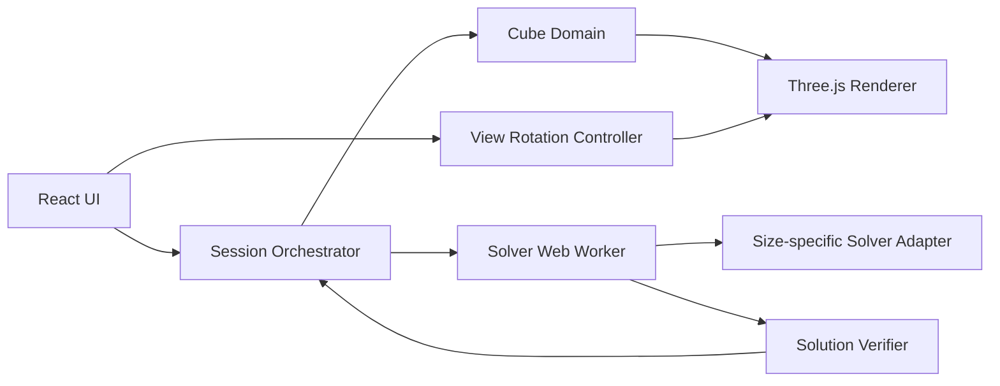
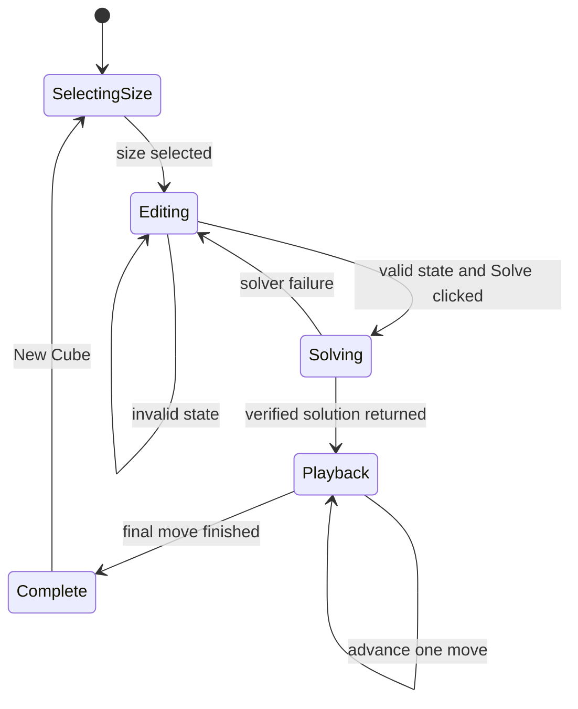
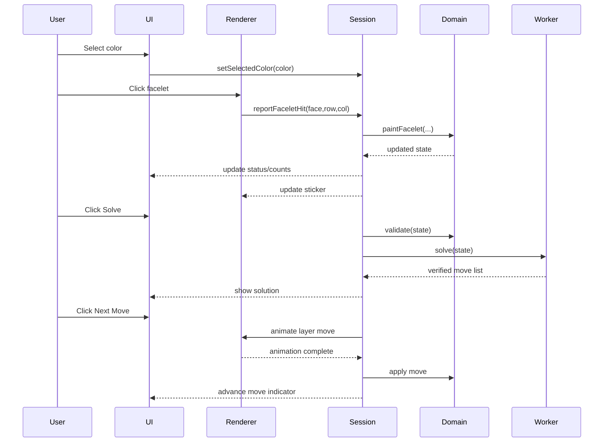

# CubeSolver Architecture

**Status:** Approved architecture baseline  
**Project type:** Offline, browser-based personal learning project  
**Initial milestone:** 3×3×3 cube solver  
**Future scope:** Incremental support for 4×4×4 through 20×20×20

## 1. Purpose and constraints

CubeSolver lets a user manually recreate a physical Rubik's Cube, validate the entered state, calculate a guaranteed-correct solution, and follow that solution interactively.

Confirmed constraints:

- Browser application with no required backend.
- Runtime works offline after the application is built.
- No camera scanning in the initial design.
- Six fixed palette colors.
- Cube starts visually white.
- The user selects a color, then clicks one square at a time to paint it.
- Previously painted squares can be recolored.
- The camera remains fixed; rotation buttons rotate the cube model.
- Exactly three faces are visible at a time.
- View rotation is animated and does not change the logical puzzle state.
- Actual layer turns occur during solution playback only.
- No incomplete-state persistence.
- Solving cannot be cancelled by the user.
- Playback advances one move at a time with adjustable animation speed.
- `New Cube` is available after the solution flow completes.
- Correctness is more important than solution optimality.
- 2×2×2 is out of scope.

## 2. Architectural principles

1. **Domain-first design:** cube rules must not depend on React or Three.js.
2. **Single source of truth:** the canonical cube state is authoritative.
3. **Separate viewing from puzzle state:** rotating the visual model must never alter the entered scramble.
4. **Verify before presenting:** every solver result is replayed and checked for a solved final state.
5. **Incremental scalability:** the 3×3 implementation establishes interfaces for larger cube sizes.
6. **No unnecessary infrastructure:** no API, authentication, cloud storage, or database is required.

## 3. High-level architecture



The application is a static single-page application. Build artifacts can be served from a local static server or static hosting; no runtime server-side computation is required.

## 4. Major modules

### Application shell

Owns the screen layout and high-level lifecycle. It enables and disables controls according to the session phase.

### Session orchestrator

Coordinates user commands and state transitions:

- Cube-size selection.
- Palette selection.
- Facelet painting.
- View rotation requests.
- Validation.
- Solve requests.
- Playback position.
- Completion and `New Cube`.

This is the only module that coordinates the complete workflow.

### Cube domain

Contains framework-independent cube logic:

- Canonical facelet state.
- Logical color identifiers.
- Face and row/column mapping.
- Move representation.
- Move application.
- Solved-state checks.
- Facelet-to-piece conversion.
- Size-specific validation and solver interfaces.

### Facelet input mapper

Converts a rendered facelet hit into a canonical `(face, row, column)` coordinate, accounting for the current display orientation. It also preserves the distinction between an unassigned facelet and an intentionally white facelet.

### Validator

For 3×3, validates completeness, color counts, center scheme, corner identity/orientation, edge identity/orientation, and permutation parity. The UI displays the required generic message, `Invalid state. Try again.`; richer diagnostics remain available internally for tests and future UX improvements.

### Move and notation module

Represents moves independently from their textual notation. A move can describe an axis, starting layer, number of affected layers, and quarter-turn amount. The 3×3 formatter supports `R`, `R'`, and `R2`; wide and inner-layer notation can be added later.

### Solver port and adapters

The application depends on a generic solver contract. Each cube size can supply a different implementation without changing the UI or renderer.

### Solution verifier

Replays a returned move sequence against a cloned state and exposes the solution only if the final state is solved.

### Three.js renderer

Owns the scene, fixed camera, cube group, facelet hit testing, view rotation animation, layer animation, move highlighting, and animation timing. It does not own the authoritative puzzle state.

## 5. Session state and lifecycle



The central state contains:

- `phase`.
- `cubeSize`.
- Canonical cube input state.
- Selected palette color.
- Discrete visual orientation.
- Solution move list.
- Current move index.
- Animation speed.
- User-facing error state.

Puzzle state, display orientation, and temporary animation state are separate values.

## 6. Cube representation

The canonical state uses a fixed face order:

```text
Up, Right, Front, Down, Left, Back
```

Each face is stored as an `N × N` row-major grid. The exact local orientation of every face is defined in one domain module and covered by tests.

Logical colors are identifiers rather than raw RGB values:

```text
White, Yellow, Red, Orange, Blue, Green, Unassigned
```

`Unassigned` is required because the initial visual cube is white, but an unpainted square must not count as an intentionally white sticker.

## 7. Communication model



The next-move action is disabled while a layer animation is active. The logical move is committed only after its animation completes.

## 8. Recommended technology stack

### Application and build

- TypeScript with strict checking.
- React for UI composition and application state.
- Vite for local development and static builds.
- Plain CSS initially; no UI component framework is required.

Vite's production build produces static assets suitable for local serving or static hosting. Runtime assets should be bundled locally rather than loaded from a CDN.

### 3D rendering

- Three.js integrated through a dedicated renderer adapter.
- Direct Three.js is preferred over React Three Fiber initially because layer selection, raycasting, and sequential animation need precise imperative control.
- The camera remains fixed while the cube group rotates for editing navigation.

### Solving

- A local solver running in a Web Worker.
- A solver adapter isolates external or custom algorithms from the rest of the codebase.
- `cubing.js` is a candidate 3×3 dependency; its version and license must be reviewed and pinned before adoption.
- A custom solver can later replace or supplement it for learning and larger-cube support.

### Testing and tooling

- Vitest for domain and application unit tests.
- Playwright for browser-level tests.
- ESLint and Prettier.
- TypeScript compiler checks.
- GitHub Actions for build, lint, type-check, and test verification.
- npm with a committed lockfile.

## 9. Backend and database

There is no backend and no database in the approved architecture.

The application does not require:

- Accounts.
- Authentication.
- Cloud synchronization.
- Server-side solving.
- Analytics.
- Persistent solution history.

State is held in memory and is discarded when a new cube is created or the page is reloaded. `localStorage` and IndexedDB are not used unless persistence becomes an explicitly approved future feature.

## 10. 3×3 validation and solving pipeline

```text
Entered facelets
    ↓
Completeness and color-count validation
    ↓
Center/color-scheme validation
    ↓
Corner and edge extraction
    ↓
Orientation and permutation validation
    ↓
Conversion to solver representation
    ↓
Local solver in Web Worker
    ↓
Conversion to internal Move objects
    ↓
Replay against a cloned state
    ↓
Solved-state verification
    ↓
Expose verified solution to UI
```

The solver result is never displayed before replay verification succeeds.

For 4×4 and larger cubes, the planned direction is reduction: solve centers, pair edges, solve the reduced 3×3-like state, then handle parity cases. These algorithms are future modules, not part of the first implementation.

## 11. Rendering and performance strategy

### 3×3 MVP

- Render clickable visible facelets.
- Use raycasting to identify a clicked square.
- Use shared geometry and materials.
- Group affected pieces temporarily for layer animation.
- Apply the logical move after animation completion.

### Larger cubes

Measure before optimizing, but plan for:

- Shared geometries.
- Shared materials.
- Instanced meshes.
- Rendering only visible surface pieces where possible.
- Reusing animation groups.
- Rebuilding only affected layers.

The logical model must support the complete cube even if the renderer uses an optimized surface representation.

## 12. Error handling

User-facing errors remain intentionally simple:

- `Invalid state. Try again.`
- A separate rendering-unavailable message if WebGL cannot initialize.
- A separate solver failure message if the local solver or worker fails.

Internal diagnostics should distinguish incomplete input, color-count errors, invalid centers, unknown pieces, orientation errors, parity errors, worker failures, and solution verification failures.

Although the user has no cancel control, worker failures and internal watchdog handling must prevent an unrecoverably frozen interface.

## 13. Security and privacy

Because there is no backend, the application has a small attack surface.

- No secrets or credentials in the frontend.
- No runtime network requests.
- No camera or personal data.
- No dynamic code evaluation.
- No unsafe HTML injection.
- Pin and review dependencies.
- Review solver-library licenses and transitive dependencies.
- Add a restrictive Content Security Policy when hosted.

## 14. Scalability and future support

The architecture scales primarily through new domain and solver implementations rather than new infrastructure:

```text
CubeDomain<N>
    ├── Validator<N>
    ├── MoveGenerator<N>
    ├── SolverAdapter<3>
    ├── SolverAdapter<4>
    └── SolverAdapter<N>
```

The UI, session lifecycle, palette, playback controls, and renderer contracts remain shared.

## 15. Essential MVP

- 3×3 size selection.
- All-white initial cube.
- Six fixed colors.
- Single-square painting and recoloring.
- Three-face view.
- Animated view rotations.
- Access to all six faces.
- In-memory state only.
- Complete 3×3 validation.
- Generic invalid-state message.
- Local verified 3×3 solution.
- Standard 3×3 notation.
- One-move-at-a-time playback.
- Direction arrows.
- Animated layer turns.
- Adjustable animation speed.
- `New Cube` after completion.
- Automated unit and browser tests.

## 16. Deferred features

- 4×4, 5×5, and larger solvers.
- Wide and inner-layer notation.
- Large-cube parity guidance.
- Optimized 20×20 rendering.
- Flat face editor for large cubes.
- Undo/redo.
- Scramble generation.
- Saved sessions and solution history.
- Camera scanning.
- Additional accessibility features.

## 17. Architecture decisions to record

- **ADR-001:** Static client-only architecture with no backend.
- **ADR-002:** TypeScript, React, and Vite.
- **ADR-003:** Direct Three.js renderer behind an adapter.
- **ADR-004:** Canonical cube state is separate from display orientation.
- **ADR-005:** Solver execution occurs in a Web Worker.
- **ADR-006:** Solver output must be replay-verified before presentation.
- **ADR-007:** Session state is in memory with no persistence.
- **ADR-008:** Cube sizes are implemented incrementally beginning with 3×3.
- **ADR-009:** Solver dependencies are isolated behind size-specific interfaces.

## 18. Approval boundary

This document records the approved architecture. Implementation planning, repository structure beyond this document, and application code should begin only after the development roadmap is agreed.

